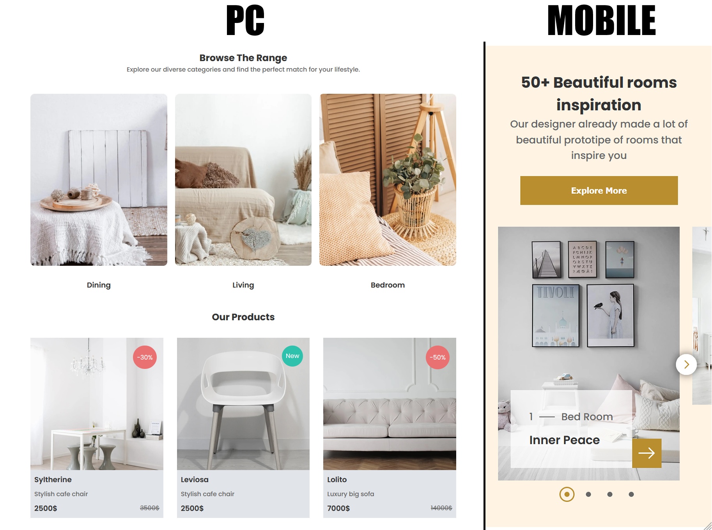

# Furniro: главная страница магазина мебели

Адаптивная вёрстка главной страницы мебельного интернет-магазина по макету из Figma Community.
Сверстана вручную на HTML и SCSS, интерактивные части написаны на чистом JavaScript.

English version: [Readme.en.md](Readme.en.md)

> Это учебная работа. Дизайн принадлежит его автору (см. «Благодарности и лицензии»).
> Моя часть: вёрстка, мобильная версия и доработки макета.

**Демо:** https://yolodreamfox.github.io/furniture-shop-page/



## О проекте

В макете Furniro есть только версия для компьютера, поэтому мобильную версию я нарисовал и сверстал сам.
Кроме того, в исходном макете были несогласованные отступы, наложения блоков и не было состояний наведения.
Я привёл всё это к единой системе и описал изменения ниже.

## Что я изменил по сравнению с макетом

- Единая шкала отступов и общие боковые поля вместо разных значений в разных блоках
- Выровнял блоки и заголовки, исправил наложения (картинка заходила на заголовок блока) и не отцентрированный заголовок
- Свёл цвета текста к нескольким ролям: основной, второстепенный, акцентный и цвет текста на кнопках
- Добавил состояния наведения и анимации: слой с действиями на карточке товара, кнопки, ссылки, карусель
- Нарисовал и сверстал мобильную версию

## Возможности

- Адаптивная вёрстка: компьютер и телефон
- Горизонтальный список категорий с «прилипанием» карточек (`scroll-snap`)
- Сетка товаров, которая подстраивается под ширину экрана, с бейджами «скидка» и «новинка» и старой ценой
- Слой с действиями при наведении на карточку товара
- Карусель с вдохновляющими интерьерами: стрелки, точки, увеличение активной карточки
- Галерея и подвал с формой подписки (подпись поднимается над полем)
- Уведомление о том, что это демо-версия

## Стек

HTML5, SCSS (`@use`, переменные, миксины), CSS-слои (`@layer`), JavaScript без фреймворков.
Шрифт: Poppins.

## Структура проекта

```
├── index.html
├── css/            скомпилированные стили
├── scss/           исходники: переменные, миксины, общие и основные стили
├── js/             карусель, уведомление, шаблоны
├── data/           
│   ├── data.js     информация
│   └── picture/    изображения
└── libs/           шрифты, иконки
```

## Запуск локально

1. Склонировать репозиторий.
2. Открыть `index.html` через локальный сервер: подойдёт расширение Live Server в VS Code
   или `python -m http.server` в папке проекта.

## Сборка стилей

Стили компилируются расширением Watch Sass для VS Code. Готовый CSS лежит в репозитории,
поэтому для просмотра сборка не нужна.

## Публикация

Страница размещена на GitHub Pages (Settings → Pages → ветка `main`, корень репозитория).

## Благодарности и лицензии

- Дизайн: eCommerce Website | Web Page Design | UI KIT | Interior Landing Page — [автор макета](https://www.figma.com/@uiux_expert), [ссылка на макет в Figma Community](https://www.figma.com/community/file/1252561852327562039/ecommerce-website-web-page-design-ui-kit-interior-landing-page), лицензия [CC BY 4.0](https://creativecommons.org/licenses/by/4.0/).
  Изменения: адаптивная версия, правки отступов, выравнивания и цветов, состояния наведения и анимации.
- Фотографии и иллюстрации из макета: источники и лицензии указаны на странице макета.
- Шрифт Poppins: SIL OFL 1.1.
- Иконки: [источник и лицензия](https://www.svgrepo.com/).

## Лицензия

Код и вёрстка: © 2026 YoLoDreamFox. Все права защищены. Код опубликован для ознакомления,
для использования в других проектах нужно разрешение автора.
Дизайн и материалы макета остаются у их авторов и используются на их условиях.